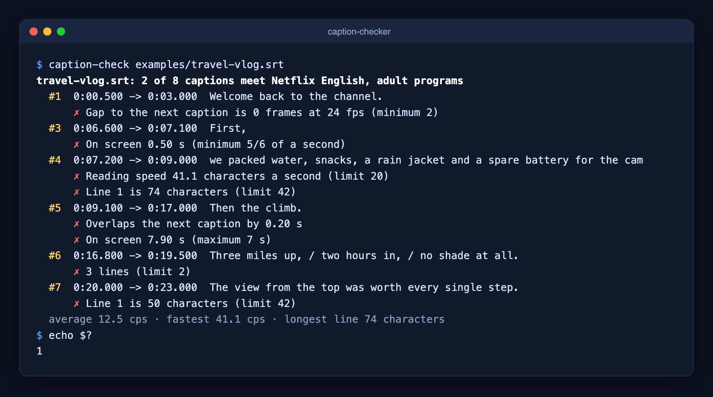

# caption-checker

Check SRT and WebVTT captions against a published caption standard: **Netflix English**, the **BBC subtitle guidelines** or the **DCMP Captioning Key**. It flags captions that read too fast, lines that are too long, too many lines, captions that stay on screen too short or too long, gaps under the minimum, overlaps and broken timestamps. It can also fix those, convert SRT to WebVTT and back, and retime a file that's out of sync.

No dependencies. Node 18+. The same checker runs in the browser, with no install and no upload, at **[markstudios.com/tools/caption-checker](https://www.markstudios.com/tools/caption-checker)**.



```
$ caption-check examples/travel-vlog.srt
travel-vlog.srt: 2 of 8 captions meet Netflix English, adult programs
  #1  0:00.500 -> 0:03.000  Welcome back to the channel.
      ✗ Gap to the next caption is 0 frames at 24 fps (minimum 2)
  #3  0:06.600 -> 0:07.100  First,
      ✗ On screen 0.50 s (minimum 5/6 of a second)
  #4  0:07.200 -> 0:09.000  we packed water, snacks, a rain jacket and a spare battery for the cam
      ✗ Reading speed 41.1 characters a second (limit 20)
      ✗ Line 1 is 74 characters (limit 42)
  ...
```

## The limits

Each limit was read on the standard's own page on 2026-10-15.

| | Netflix (English) | BBC | DCMP Captioning Key |
|---|---|---|---|
| Reading speed | Up to 20 characters a second (adult), 17 (children’s) | 160–180 words a minute | Up to 130 / 140 / 160 words a minute (lower / middle / upper level) |
| Characters a line | 42 | 37 on broadcast (Teletext) | No character count |
| Lines a caption | 2 | 2; 3 for vertical 9:16 video | No more than 2 preferred |
| Shortest time on screen | 5/6 of a second | About 0.3 s a word (advice) | 40 frames (1 second and 10 frames) |
| Longest time on screen | 7 seconds | No number | 6 seconds |
| Gap between captions | 2 frames minimum; gaps under 0.5 s closed to 2 frames | If you leave a gap, at least 1 second (advice) | No rule |

Sources: [Netflix English (USA) Timed Text Style Guide](https://partnerhelp.netflixstudios.com/hc/en-us/articles/217350977-English-USA-Timed-Text-Style-Guide) · [Netflix General Requirements](https://partnerhelp.netflixstudios.com/hc/en-us/articles/215758617-Timed-Text-Style-Guide-General-Requirements) · [Netflix Subtitle Timing Guidelines](https://partnerhelp.netflixstudios.com/hc/en-us/articles/360051554394-Timed-Text-Style-Guide-Subtitle-Timing-Guidelines) · [BBC Subtitle Guidelines](https://www.bbc.co.uk/accessibility/forproducts/guides/subtitles/) · [DCMP Captioning Key: Text](https://dcmp.org/learn/597-captioning-key---text) · [DCMP Captioning Key: Presentation Rate](https://dcmp.org/learn/601-captioning-key---presentation-rate)

**How it counts.** Characters include letters, spaces and punctuation, but not line breaks or formatting (`<i>` tags, `{\an8}` codes, WebVTT voice spans). Reading speed is characters ÷ (out-time − in-time). Words are runs of characters that hold a letter or a digit, so speaker labels and sound tags count, as DCMP asks. Gaps run from one caption's out-time to the next caption's in-time, in frames at the frame rate you give. Anything a standard words as a recommendation is reported as advice, not as a failure.

## CLI

```
npx github:markksantos/caption-checker captions.srt
# or: git clone https://github.com/markksantos/caption-checker && node caption-checker/bin/caption-check.js captions.srt

caption-check <file.srt|file.vtt> [more files] [options]
  -s, --standard <id>   netflix | netflix-kids | bbc | dcmp-upper | dcmp-middle | dcmp-lower  (default: netflix)
  -f, --fps <rate>      frame rate for frame-gap checks (default: 24)
      --vertical        9:16 video (the BBC allows three lines)
      --json            JSON output
      --advice          also print advice-only notes
      --fix <out>       write a fixed copy to <out> (one input file)
      --mcp             run as an MCP server on stdio

caption-check <file> --to vtt|srt [--speakers] [--crlf] [--out <file>]                     convert
caption-check <file> --shift <time> [--from <n>] | --start-at <n=time> | --rate <from:to> | --sync <n=time,n=time>
              [--to vtt|srt] [--out <file>]                                                retime
```

It exits with 1 when any caption breaks a limit, so it works as a CI check before captions ship.

## Fix mode

`--fix` writes a copy with every fix that doesn't need a person: it never changes a word or an in-time.

```
$ caption-check examples/travel-vlog.srt --fix fixed.srt
travel-vlog.srt: 8 changes in 7 captions, written to fixed.srt
  #1  Out-time 0:03.000 -> 0:02.916 (to leave 2 frames before the next caption)
  #4  Rewrapped to 2 lines (38 + 35 characters)
  #5  Out-time 0:17.000 -> 0:16.100 (off an overlap, to the 7 s maximum)
  ...
  Left for a person (2):
  #3  Still on screen only 0.52 s (minimum 5/6 of a second) with no free time after it: merge it with a neighbor or move the next caption
  #4  Still reads at 40.2 characters a second (limit 20) with no free time after it: split it, condense it or move the next caption
fixed.srt: 6 of 8 captions meet Netflix English, adult programs (before: 2 of 8)
```

- **Line breaks.** A caption with a line over the limit, or too many lines, is rewrapped into the fewest lines that fit, breaking after punctuation where it can and avoiding a break after an article, preposition, conjunction or auxiliary verb ("the", "of", "and", "was"). Captions with formatting tags or two speakers are left for a person.
- **Out-times.** An out-time is pulled back off an overlap or a gap under the minimum, cut to the longest time on screen, and pushed into free time when a caption is too short or reads too fast. For Netflix, gaps under 0.5 s are closed to 2 frames, as its timing guide asks.
- **Everything else stays.** Captions that needed nothing keep their exact bytes, and so do cue ids, WebVTT headers, NOTE blocks, cue settings, line endings and a byte-order mark. A second run changes nothing.

Run against 300 caption files with all six standards, it never changed a word, an in-time or the number of captions, and never left more captions failing than it started with.

## Convert and retime

`--to` converts SubRip to WebVTT or back; the retiming flags fix captions that are out of sync with the video. Without `--out`, the file goes to stdout and the summary to stderr.

```
$ caption-check examples/travel-vlog.srt --to vtt --out travel-vlog.vtt
travel-vlog.srt: 8 captions converted from SubRip (.srt) to WebVTT (.vtt).
Written to travel-vlog.vtt
$ caption-check episode.srt --shift -2.5 --from 120 --out episode.synced.srt     # late by 2.5 s from caption 120 on
$ caption-check film.srt --rate 23.976:25 --out film.25fps.srt                     # timed for 23.976 fps, video is 25 fps
$ caption-check film.srt --sync 1=0:04.200,640=41:12.5 --out film.synced.srt       # pin two captions, stretch the rest
```

- **Converting** keeps every caption's text and timing. Italic, bold and underline stay; SubRip `{\an8}`-style position codes become WebVTT `line`/`align` settings and back; `&` and `<` are escaped for WebVTT and unescaped for SubRip; `<v Name>` voice tags become "Name: " with `--speakers`. Whatever the other format can't hold (font colours, NOTE blocks, WebVTT position or size) is listed, not silently dropped.
- **Retiming** works on integer milliseconds, so nothing drifts from rounding. A two-point sync says when the stretch matches a common frame-rate pair (23.976/25, 24/25, 29.97/30 ...). Times pushed before 0:00 are clamped and counted.

It uses the same reader and writer as the online [SRT to VTT converter](https://www.markstudios.com/tools/srt-vtt-converter) and [subtitle time shifter](https://www.markstudios.com/tools/subtitle-time-shift) (`subtitles.js` is that code, unchanged). Run on 300 caption files (34,836 captions), SRT to WebVTT and back kept every caption's timing, and a shift there and back restored every time.

## Library

```js
const { parse, check, fix } = require('caption-checker');
const result = check(parse(fs.readFileSync('captions.vtt', 'utf8')), 'bbc', { vertical: true });
console.log(result.flagged, 'of', result.cues.length, 'captions break a limit');
for (const cue of result.cues) for (const issue of cue.issues) console.log(cue.n, issue.severity, issue.message);

const fixed = fix(fs.readFileSync('captions.srt', 'utf8'), 'netflix', { fps: 25 });
fs.writeFileSync('captions.fixed.srt', fixed.text);   // also: fixed.changes, fixed.unresolved, fixed.before, fixed.after

const { convert, retime } = require('caption-checker/convert.js');
const vtt = convert(srtText, 'vtt');                                   // { text, from, to, captions, notes }
const synced = retime(srtText, { rate: { from: 23.976, to: 25 } });    // or { offset: '-2.5', from: 120 }, { startAt: { caption, time } }, { sync: [a, b] }
```

`check()` accepts a standard id or your own standard object with the same fields as `STANDARDS` in `index.js`.

## MCP server and Claude Code plugin

The same checks run as an MCP server, so Claude, Cursor, VS Code and other MCP clients can check a caption file mid-task. Five tools: `check_captions` (a file path or pasted SRT/VTT text, a standard, fps, vertical), `fix_captions` (the same arguments; returns the fixed file and what changed), `convert_captions` (SRT to WebVTT or back), `retime_captions` (offset, start at, frame-rate change or two-point sync) and `list_standards` (each limit and the page it comes from). It runs locally: no key, no network.

```
# Claude Code plugin (MCP server + a caption QA skill)
/plugin marketplace add markksantos/caption-checker
/plugin install caption-checker@caption-checker

# or the server on its own
claude mcp add caption-checker -- npx -y github:markksantos/caption-checker --mcp
```

Other clients:

```json
{ "mcpServers": { "caption-checker": { "command": "npx", "args": ["-y", "github:markksantos/caption-checker", "--mcp"] } } }
```

The skill in [`skills/caption-checker/SKILL.md`](skills/caption-checker/SKILL.md) tells an agent which standard to pick, how to report results and how to fix a caption without changing its words. [`skills/caption-fixer/SKILL.md`](skills/caption-fixer/SKILL.md) covers fixing a file: what `fix_captions` changes, and what to do with the captions it leaves for a person. [`skills/caption-converter/SKILL.md`](skills/caption-converter/SKILL.md) covers converting between SRT and WebVTT and working out which kind of timing fix an out-of-sync file needs.

## Study

[`study/`](study) holds the code and data behind the [caption reading speed study](https://www.markstudios.com/research/caption-reading-speed-study): 339,521 captions in 387 NASA videos and MIT OpenCourseWare lectures, measured with this library.

[`study-auto-captions/`](study-auto-captions) holds the [YouTube auto-caption accuracy study](https://www.markstudios.com/research/youtube-auto-caption-accuracy-study): automatic vs human captions on 299 videos, plus caption coverage of the most-subscribed channels.

[`study-dubbing/`](study-dubbing) holds the [YouTube dubbing study](https://www.markstudios.com/research/youtube-dubbing-study): every audio track on 485 videos from the 97 most-subscribed channels, split into the channels' own dubs and YouTube's automatic ones.

[`study-video-length/`](study-video-length) holds the [YouTube video length study](https://www.markstudios.com/research/youtube-video-length-study): durations of 2,859 latest videos and the Shorts share of 1,484 recent uploads on the most-subscribed channels.

## Version history

See [CHANGELOG.md](CHANGELOG.md) and [releases](https://github.com/markksantos/caption-checker/releases).

## Tests

```
npm test
```

## License

MIT © [Mark Studios](https://www.markstudios.com), a [video editing](https://www.markstudios.com/services/video-editing) and production studio.
